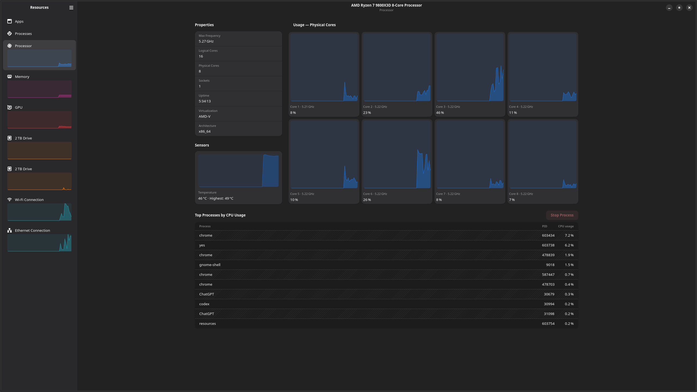
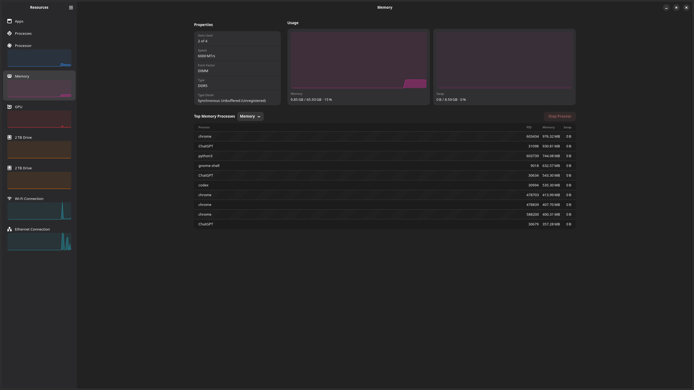

# Ubuntu Resource Monitor

Ubuntu Resource Monitor is a Linux desktop resource monitor based on [GNOME Resources](https://gitlab.gnome.org/GNOME/Incubator/Resources). This unofficial fork of Resources 1.10.2 adds live top-process rankings to the hardware views so you can see which processes are driving resource usage.



## What's different

- See the top 10 processes for CPU, memory, GPU, disk, network, and supported NPUs. Where the table has multiple metrics, use **Rank by** to switch between them.
- Click the CPU usage chart or its heading to cycle through total usage, physical cores, and logical threads.
- Hold **Ctrl** to freeze a hardware process table. Use **Stop Process** to suspend a selected process and **Continue Process** in the Processes view to resume it.
- Search is always visible in Apps and Processes. **Ctrl+F** focuses it and **Esc** clears it. The Processes view keeps its scroll position as rows reorder.

Drive rankings use system-wide per-process disk I/O. Network rankings cover visible TCP connections and match them to interfaces by local address. The network sampler uses `ss` from iproute2 and covers TCP only.



## Build and run

You need Meson, Ninja, gettext, Rust and Cargo (Rust 1.85 or later), and development files for GLib (2.66+), GTK (4.12+), and libadwaita (1.8+).

From a checkout of this repository, build and install to a dedicated per-user prefix.

```sh
prefix="${XDG_DATA_HOME:-$HOME/.local/share}/ubuntu-resource-monitor"
meson setup build --prefix="$prefix" -Dprofile=default
meson compile -C build
meson install -C build
```

Run the installed app with its own schemas and data files.

```sh
prefix="${XDG_DATA_HOME:-$HOME/.local/share}/ubuntu-resource-monitor"
GSETTINGS_SCHEMA_DIR="$prefix/share/glib-2.0/schemas" \
XDG_DATA_DIRS="$prefix/share:${XDG_DATA_DIRS:-/usr/local/share:/usr/share}" \
"$prefix/bin/resources"
```

## Licence

This fork is licensed under [GNU GPL version 3 or later](LICENSE). It includes modifications to Resources 1.10.2 made on 9–10 November 2026. See the [upstream source at the base revision](https://github.com/nokyan/resources/tree/b99edbf) for the original project.
